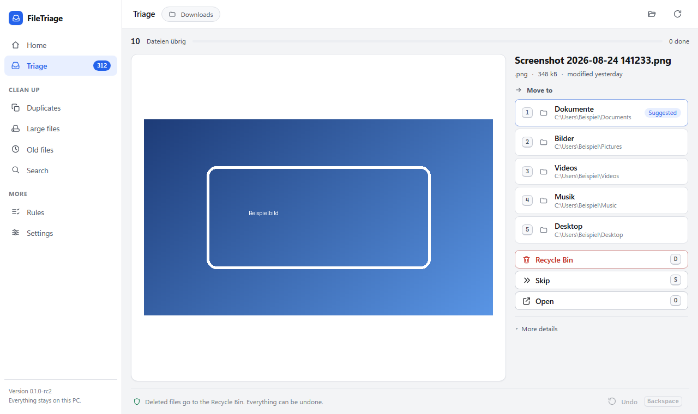

# FileTriage

**Inbox Zero for your files.**

Fast. Local. Reversible.

FileTriage is a focused Windows file organizer: choose a folder, review one file at a time, and move, keep, skip, rename, or send it to the Recycle Bin with keyboard or mouse.

> **Source Available**
>
> **Free for personal and non-commercial use.**
>
> Commercial use requires a separate license: [kontakt@saveroq.com](mailto:kontakt@saveroq.com)



## What FileTriage does

- Fast one-file-at-a-time triage with previews and keyboard shortcuts.
- Undo for individual actions and complete sessions.
- Duplicate detection using size, partial hashes, and full hashes.
- Views for large and old files plus local indexed search.
- Rules and filename-pattern suggestions with a dry-run preview before execution.
- Collision handling that never silently overwrites a file.
- Persistent journal and recovery workflow for interrupted operations.
- Local processing with no FileTriage account, cloud upload, telemetry, or analytics.

Rules never run silently in the background. They identify candidates, show the count, size, target, and collisions, and require confirmation before changing files.

## Download

Installers and SHA-256 checksums are published on the [GitHub Releases](https://github.com/Relis-lol/FileTriage/releases) page. FileTriage is currently unsigned, so Windows SmartScreen may warn about an unknown publisher. Verify the published checksum before running an installer.

## Community build

The public build uses the `community` distribution channel. It has full functionality for uses permitted by the license, no trial period or expiry, no activation, no account, no Microsoft Store dependency, and no network requirement. The non-commercial restriction is a license condition, not DRM.

## Building from source

Requirements:

- Windows 10 or 11;
- Rust stable with the MSVC toolchain (the crate declares Rust 1.85 or newer);
- Visual Studio Build Tools with the C++ workload and a Windows SDK; and
- Microsoft Edge WebView2 Runtime.

Build and test:

```powershell
Set-Location src-tauri
cargo test --locked
cargo build --release --locked
```

Build the hardened Community executable or NSIS installer from the repository root:

```powershell
powershell -ExecutionPolicy Bypass -File tools\build-release.ps1 -Channel community
powershell -ExecutionPolicy Bypass -File tools\build-release.ps1 -Channel community -Bundle
```

The executable is written to `src-tauri/target/release/filetriage.exe`; Tauri writes the NSIS bundle below `src-tauri/target/release/bundle/nsis/`. The checked-in `Cargo.lock` fixes Rust dependency versions. No developer secret or private service is required.

## Privacy

FileTriage processes file metadata and requested operations locally. It contains no application telemetry, analytics, account, cloud upload, or own server calls. The local SQLite index stores metadata, settings, rules, hashes used for duplicate detection, and the action journal, but not file contents. See [PRIVACY.md](PRIVACY.md).

## Safety and recovery

Productive move, rename, delete, and rule-driven file operations are journaled persistently before the file system is changed. If the persistent journal is unavailable or recovery is unresolved, mutations fail closed while scanning and diagnosis remain available. Undo validates the original recorded action and does not overwrite conflicts. Deletion uses the Windows Recycle Bin by default.

These controls reduce risk but cannot guarantee against every form of data loss. Keep independent backups of important files. See [SECURITY.md](SECURITY.md) and [ARCHITECTURE.md](ARCHITECTURE.md).

## License

FileTriage-owned code is licensed under the [PolyForm Noncommercial License 1.0.0](LICENSE), SPDX identifier `PolyForm-Noncommercial-1.0.0`.

This is a **Source Available** license, not an OSI Open Source license. It permits noncommercial use and, for permitted noncommercial purposes, modifications, new works, and distribution subject to its terms and required notices. Public GitHub forks are not prohibited.

Commercial use requires a separate written license. See [COMMERCIAL-LICENSING.md](COMMERCIAL-LICENSING.md) or email [kontakt@saveroq.com](mailto:kontakt@saveroq.com). Third-party components retain their own licenses; see [THIRD_PARTY_NOTICES.md](THIRD_PARTY_NOTICES.md) and `LICENSES/`.

Copyright 2026 Björn Boldt. Saveroq is the project/brand contact; it is not presented here as a separate legal licensor.

## Contributing and security

Bug reports and suggestions are welcome. Because FileTriage is dual-licensed, code contributions are accepted only by prior written agreement; see [CONTRIBUTING.md](CONTRIBUTING.md). Report vulnerabilities privately as described in [SECURITY.md](SECURITY.md).

## Contact and legal

- Licensing, support, and security: [kontakt@saveroq.com](mailto:kontakt@saveroq.com)
- Provider information / legal notice: [Saveroq Impressum](https://saveroq.com/impressum)
